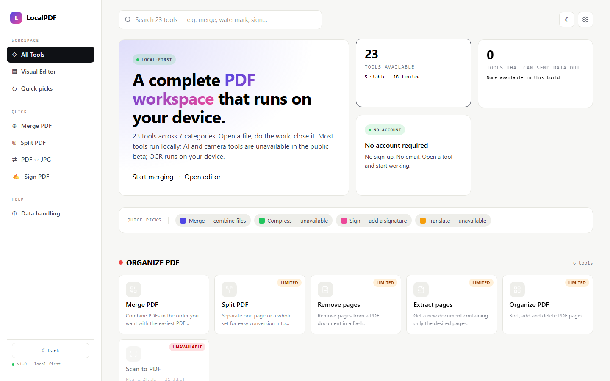
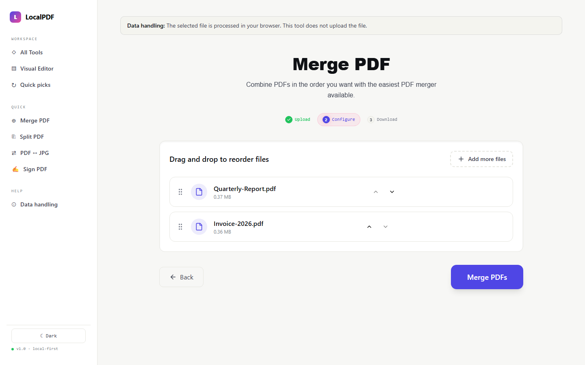
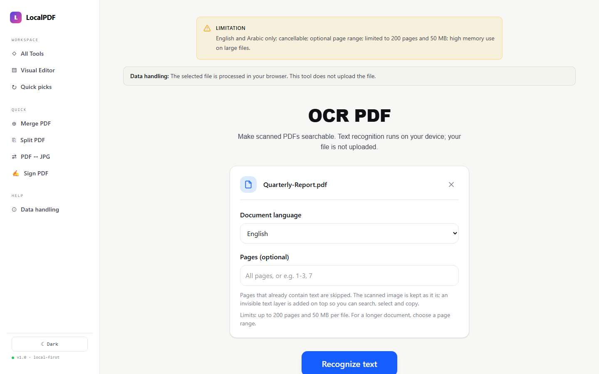
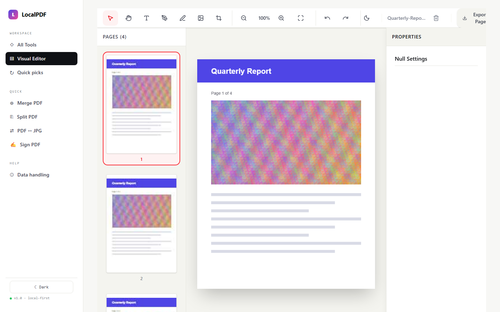
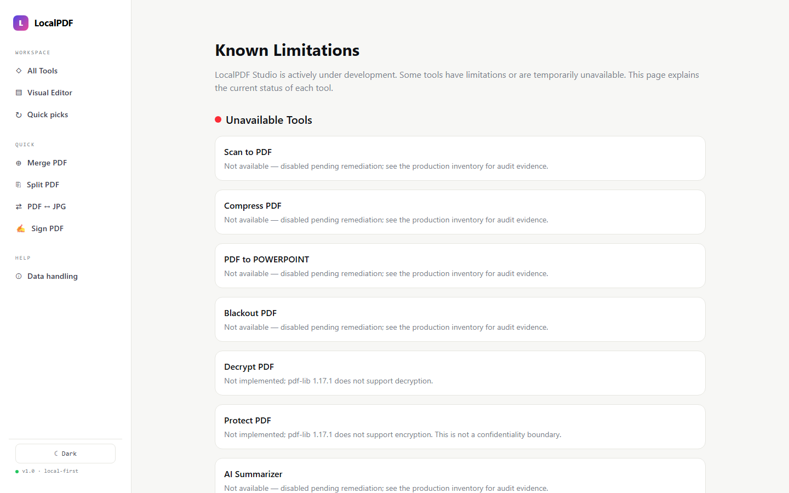

# LocalPDF Studio

**A privacy-first PDF toolkit that runs entirely on your device.** Merge, split, edit, sign, convert and OCR your PDFs in the browser or in a native desktop app. Your files are never uploaded.


**English** | [العربية](README.ar.md)

<p align="center">
  
</p>

---

## Screenshots

<picture>
  <source media="(prefers-color-scheme: dark)" srcset="docs/assets/screenshots/home-dark.png">
  
</picture>

| Merge PDF | OCR PDF |
|---|---|
| <picture><source media="(prefers-color-scheme: dark)" srcset="docs/assets/screenshots/merge-dark.png"></picture> | <picture><source media="(prefers-color-scheme: dark)" srcset="docs/assets/screenshots/ocr-dark.png"></picture> |
| **Editor** | **Known limitations** |
|  | <picture><source media="(prefers-color-scheme: dark)" srcset="docs/assets/screenshots/limitations-dark.png"></picture> |

Screenshots follow your GitHub light or dark theme.

## Why LocalPDF Studio

Most online PDF tools upload your document to their servers. LocalPDF Studio doesn't:

- **🔒 Local processing.** Every enabled tool works on the file inside your browser tab. No upload, no account, no tracking of document content.
- **🧾 Honest about every tool.** Each tool has a release state (`stable`, `limited` or `disabled`). Its page shows what it does, what it doesn't do yet, and where your data goes. Tools that aren't ready are switched off, not shipped broken.
- **🛡️ Locked down by default.** A strict Content-Security-Policy allows no third-party hosts, scripts or workers. OCR engines and language data are self-hosted. The browser tests check that tool routes contact only the app's own origin.
- **🖥️ Web and desktop.** The same code also ships as a lightweight [Tauri 2](docs/desktop.md) desktop app with native file dialogs.

## Highlights

### 🔍 OCR: make scanned PDFs searchable *(new)*
- Recognizes text on scanned pages with **Tesseract running in your browser**. The worker, the WASM core and the English and Arabic language data are all served from the app itself.
- Adds an **invisible, word-aligned text layer**, so search and selection line up with the scanned image, even on rotated pages.
- Skips pages that already have text, so search hits are not doubled.
- **Cancellable at any point**: the Cancel button stops the engine, even in the middle of a page.
- **Optional page range** (`1-3, 7`), plus clear limits: 200 pages and 50 MB per run.

### ✏️ Editor
A full-page editor that adds text, drawings, images and visual signatures, with page thumbnails, undo/redo and keyboard shortcuts (press `?`).

### 🗂️ Organize and convert
Merge, split, rotate, crop, reorder, extract and compare pages. Convert between PDF and JPG, Word, Excel, PowerPoint and HTML, with page numbers, watermarks and repair alongside.

### ♿ Built to a quality bar
- 775 unit and component tests (Vitest + Testing Library).
- Playwright smoke and **axe accessibility** gates against the production build.
- Lighthouse CI, a bundle-size budget, and type checking and linting in CI.
- Dark mode, an onboarding tour, toast notifications, and per-tool error boundaries.

## Tool status

The source of truth is [`src/config/featureRegistry.ts`](src/config/featureRegistry.ts). The app shows each tool's limitations on the tool's own page.

| State | Tools |
|---|---|
| ✅ **Stable** | Merge PDF · PDF to JPG · Rotate PDF · Crop PDF · Compare PDF |
| 🟡 **Limited**: works, with documented limits | OCR PDF *(English, Arabic)* · Split PDF · Remove Pages · Extract Pages · Organize PDF · Repair PDF · JPG to PDF · HTML to PDF · Word to PDF · Excel to PDF · PowerPoint to PDF · PDF to PDF/A *(best-effort, not conformant)* · PDF to Word · PDF to Excel · Add Page Numbers · Add Watermark · Edit PDF *(adds overlays)* · Sign PDF *(visual signature, not certificate-backed)* |
| ⛔ **Disabled**: work in progress | Compress PDF · Scan to PDF · PDF to PowerPoint · Protect PDF · Unlock PDF · Redact (Blackout) PDF · AI Summarizer · Translate PDF |

The Phase A plan for turning the disabled tools on is in [`docs/superpowers/plans/2026-10-24-phase-a-tools.md`](docs/superpowers/plans/2026-10-24-phase-a-tools.md).

## Quick start

Requirements: Node.js `22.14.0` and npm `11.16.0` (pinned in `package.json` engines; [fnm](https://github.com/Schniz/fnm) + Corepack recommended).

```sh
fnm install 22.14.0 && fnm use 22.14.0
corepack enable npm && corepack prepare npm@11.16.0 --activate

npm ci          # install the exact locked dependency graph
npm run dev     # http://localhost:3000
```

No API keys or environment setup are needed. The web build neither reads nor accepts an API key. `VITE_*` values would be inlined into public JavaScript, so `VITE_GEMINI_API_KEY` is intentionally not read.

### Desktop app

```sh
npm run tauri:dev     # requires Rust + MSVC build tools on Windows
npm run tauri:build
```

See [docs/desktop.md](docs/desktop.md) for prerequisites and details.

## Commands

| Command | What it does |
|---|---|
| `npm run dev` | Dev server on port 3000 |
| `npm run build` | Production build into `dist/` |
| `npm run preview` | Serve the production build |
| `npm run typecheck` | TypeScript (`tsc --noEmit`) |
| `npm run lint` | ESLint |
| `npm test` | Unit and component tests (Vitest) |
| `npm run test:coverage` | Tests with a coverage report |
| `npm run test:e2e` | Playwright smoke and accessibility gates against the production build |
| `npm run check:bundle` | Per-chunk bundle-size budget |
| `npm run test:lhci` | Lighthouse CI |

Browser tests need Chromium installed once (`npx playwright install chromium`) and a build (`npm run build`). `npm run test:e2e` starts its own `vite preview` server on `127.0.0.1:4173`.

## Tech stack

| Area | Choice |
|---|---|
| UI | React 19, TypeScript, Tailwind CSS v4 |
| Build | Vite 6, with heavy libraries split into lazy chunks |
| PDF | pdf-lib (writing), pdfjs-dist (rendering and text) |
| OCR | tesseract.js 5, self-hosted worker, core and `tessdata_fast` data |
| Office | mammoth, docx, exceljs |
| State | Zustand |
| Desktop | Tauri 2 (Rust) |
| Testing | Vitest, Testing Library, Playwright, axe-core, Lighthouse CI |

## Project structure

```
src/
├── components/   # editor, shared tool UI (upload zone, processing state, availability gate), layout
├── config/       # featureRegistry: release state, privacy class and limits for every tool
├── pages/tools/  # one page per tool (31)
├── lib/          # PDF, OCR, compression, conversion and security logic
├── store/        # Zustand stores
├── constants/    # tool catalog, limits
└── tests/        # setup, fixtures, helpers
e2e/              # Playwright smoke + accessibility specs
src-tauri/        # desktop shell
docs/             # privacy data flow, release inventory, plans, competitive analysis
```

## Privacy and security

- [docs/privacy/data-flow.md](docs/privacy/data-flow.md) describes, per tool, where data goes and the release gate a tool must pass before it is enabled.
- [docs/release/production-inventory.md](docs/release/production-inventory.md) holds the audit evidence for every tool's release state.
- Known limits are stated plainly. Signing is visual, not cryptographic. The dedicated blackout/redaction tool and password protection are disabled until they are real. OCR currently supports English and Arabic.

## Roadmap

- **Compression:** real image downsampling is implemented and awaits verification before release.
- **Protect / Unlock:** real AES encryption via a self-hosted qpdf (WASM) build.
- **True redaction** that removes the underlying content, not just covers it.
- **Scan to PDF** with an image-file fallback.
- More OCR languages (French, German, Spanish, …).
- Higher-fidelity Office conversions.

## License

[MIT](LICENSE)
